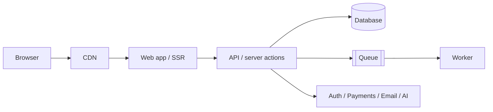

<!-- Template: architecture | Filled by: /create-architecture (technical-director, leads) | Output: docs/architecture/architecture.md -->
# Architecture — [PRODUCT NAME]

Updated: [YYYY-MM-DD] · ADRs: docs/architecture/adr/

## Overview

[ONE PARAGRAPH]

## Stack
| Layer | Choice | ADR |
|---|---|---|
| Frontend | [FRAMEWORK + VERSION] | ADR-0001 |
| Backend | [FRAMEWORK] | |
| Database / ORM | [DB / ORM] | |
| Hosting | [HOST] | |
| Auth / Payments / Email / CMS / AI | [PROVIDERS] | |

## Rendering strategy
| Route group | Strategy (SSG/ISR/SSR/CSR) | Cache / revalidation | Why |
|---|---|---|---|

## Code organisation
```
[src/ TREE: app/, components/, features/<feature>/, lib/, server/, db/]
```
Module boundaries: [RULES, E.G. features don't import each other's internals]

## Data flow
- Reads: [HOW]
- Writes: [VALIDATION → AUTHZ → DOMAIN → DB → EVENTS]
- Background jobs: [WHAT RUNS ASYNC]

## Auth & authorisation model
[SESSIONS, ROLES, TENANCY, WHERE CHECKS LIVE]

## Environments
| Env | URL | Data | Deploy trigger |
|---|---|---|---|
| local | localhost | seeds | — |
| preview | per PR | seeded | PR |
| production | [DOMAIN] | real | main (manual approval) |

## Cross-cutting
- Errors & logging: [APPROACH] · Observability: [TOOLS]
- Caching: [LAYERS] · Rate limiting: [WHERE]
- i18n: [APPROACH] · Feature flags: [TOOL]

## Quality attributes
| Attribute | Target | How achieved |
|---|---|---|
| Performance | project.yaml budgets | [MEASURES] |
| Availability | [99.9%] | [MEASURES] |
| Security | [OWASP ASVS L1] | [MEASURES] |

## Risks & open questions
- [RISK]
