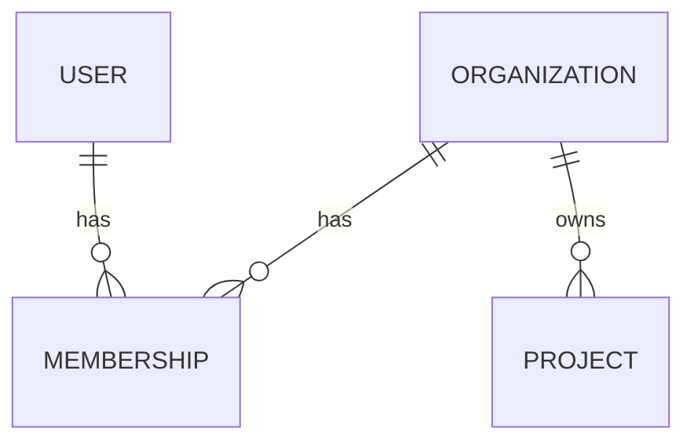

<!-- Template: data-model | Filled by: /data-model (lead-backend, data-engineer) | Output: docs/architecture/data-model.md -->
# Data Model — [PRODUCT NAME]

Database: [postgres | mongodb | …] · ORM: [prisma | drizzle | …] · Updated: [YYYY-MM-DD]
Tenancy: [single-tenant | org_id column + scoped queries | RLS]

## Entity diagram

## Entities
### [ENTITY]
| Field | Type | Null | Default | Constraints / notes |
|---|---|---|---|---|
| id | uuid | no | gen | PK |
| org_id | uuid | no | | FK → organization.id, ON DELETE CASCADE |
| [FIELD] | [TYPE] | [yes/no] | | [UNIQUE, CHECK…] |
| created_at | timestamptz | no | now() | |
| updated_at | timestamptz | no | now() | |
Indexes: [(org_id, created_at DESC)] — serves: [QUERY]
Personal data: [FIELDS] — retention: [RULE]

## Invariants
- [RULE ENFORCED BY THE DB, E.G. ONE OWNER PER ORG]

## Access patterns
| Query | Frequency | Index used |
|---|---|---|

## Data classes & retention
| Class | Examples | Retention | Deletion method |
|---|---|---|---|
| Account | email, name | while active + [30d] | hard delete + processor notice |

## Migration log
| # | Date | Change | Expand/contract phase |
|---|---|---|---|
