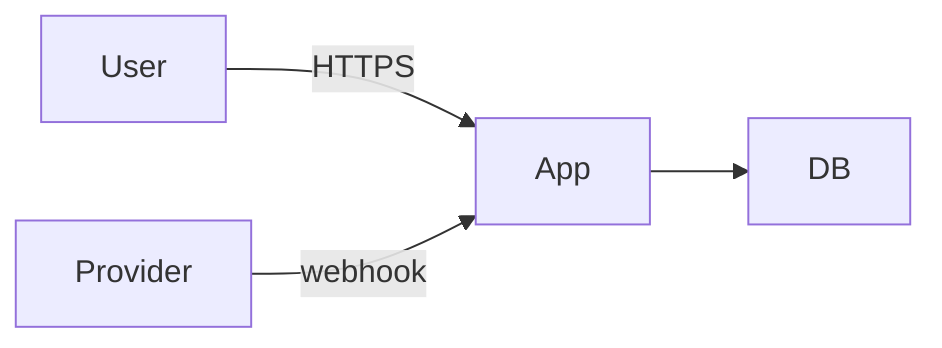

<!-- Template: threat-model | Filled by: /security-audit, /feature-spec (security-lead) | Output: docs/architecture/threat-models/<feature-slug>.md -->
# Threat Model — [FEATURE / SYSTEM]

Date: [YYYY-MM-DD] · Reviewer: security-lead · Spec: [LINK]

## Scope & assets
- Assets: [USER DATA, PAYMENT STATE, ADMIN ACCESS, API KEYS]
- Entry points: [ROUTES, WEBHOOKS, UPLOADS, WEBSOCKETS]
- Trust boundaries: [BROWSER ↔ SERVER, SERVER ↔ THIRD PARTY, TENANT ↔ TENANT]

## Data flow

## Threats (STRIDE)
| ID | Category | Threat | Likelihood | Impact | Mitigation | Status |
|---|---|---|---|---|---|---|
| T1 | Spoofing | [SESSION THEFT] | [M] | [H] | [HttpOnly/Secure/SameSite cookies, rotation] | [open/mitigated] |
| T2 | Tampering | [FORGED WEBHOOK] | | | [signature verification + replay window] | |
| T3 | Repudiation | [NO AUDIT TRAIL FOR ADMIN ACTIONS] | | | [audit log] | |
| T4 | Information disclosure | [IDOR ACROSS TENANTS] | | | [object-level authz tests] | |
| T5 | Denial of service | [UNBOUNDED UPLOADS / QUERIES] | | | [size limits, rate limits, pagination] | |
| T6 | Elevation of privilege | [ROLE ESCALATION VIA MASS ASSIGNMENT] | | | [allowlisted fields] | |

## Abuse cases
- [AS AN ATTACKER, I …]

## Residual risk (user decision required)
| Risk | Why accepted | Decided by | Date |
|---|---|---|---|
