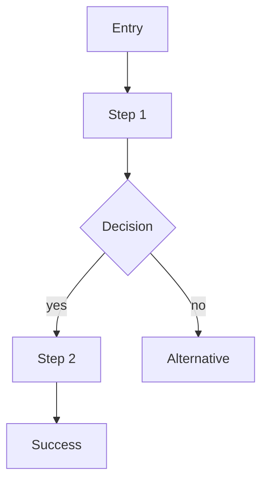

<!-- Template: ux-flow | Filled by: /ux-flow (ux-lead) | Output: docs/design/ux/<flow-slug>.md -->
# UX Flow — [FLOW NAME]

PRD: [FR-IDs] · Persona: [PERSONA] · Critical journey: [yes/no] · Updated: [YYYY-MM-DD]

## Goal
[WHAT THE USER IS TRYING TO ACHIEVE] · Success = [OBSERVABLE OUTCOME]

## Entry points
- [WHERE USERS START: LINK, EMAIL, DEEP LINK]

## Happy path

1. [STEP] — screen: [SCREEN] — system response: [RESPONSE]

## Alternative and error paths
| Trigger | What the user sees | Recovery |
|---|---|---|
| Validation error | [INLINE MESSAGE] | [FIX AND RESUBMIT] |
| Network / server error | [MESSAGE] | [RETRY, INPUT PRESERVED] |
| Not authorised | [MESSAGE] | [LOGIN / REQUEST ACCESS] |
| Empty data | [EMPTY STATE] | [PRIMARY ACTION] |

## Screens involved
- [SCREEN] → wireframe: [LINK]

## Accessibility notes
- Focus order: [ORDER] · Announcements: [LIVE REGIONS] · Keyboard: [SHORTCUTS / TRAPS]

## Analytics events
- [object_action] at step [N]

## Open questions
- [QUESTION]
